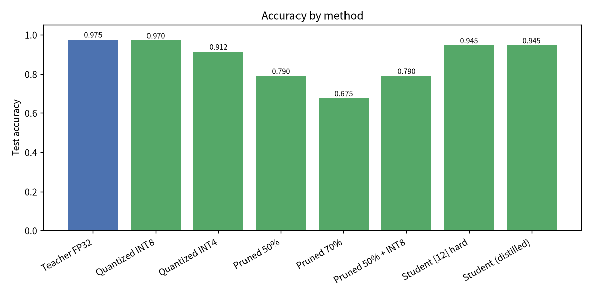

# 🗜️ ModelShrink

**🌐 Language: [简体中文](docs/README.zh-CN.md) · [繁體中文](docs/README.zh-TW.md) · English**

> A tiny, dependency-light neural-network compression toolbox — **quantization**,
> **pruning** and **knowledge distillation** in pure NumPy, running on the CPU in
> seconds. No PyTorch/TensorFlow, no GPU, no config soup. 🍃

[](LICENSE)
[](https://www.python.org/)
[](https://numpy.org/)

---

## 🎉 Introduction

Modern neural networks are wildly over-parameterized. The same accuracy can
usually be delivered by a model that is **4×, 8×, even 18× smaller**. But the
classic compression techniques live scattered across heavy frameworks, which
makes them hard to *actually see and run* while learning.

**ModelShrink** bundles the three workhorse techniques into one transparent,
runnable toolkit:

- **Quantization** — store weights with fewer bits (INT8 / INT4).
- **Pruning** — remove redundant weights (sparsity).
- **Knowledge distillation** — transfer a big "teacher" into a tiny "student".

Everything is implemented from scratch in **pure NumPy**: the network, the
forward/backward passes, the optimizer, and all three compression algorithms.
The whole demo trains and evaluates in **~4 seconds on a laptop CPU**.

It is ideal for **learning & teaching**, for **rapid prototyping**, and as a
readable reference of *how* these techniques actually work. Inspiration comes
from the "unified model-optimization library" category of projects; the code
here is independent and written for clarity rather than framework coverage.

## ✨ Features

- 🪶 **Truly lightweight** — the only runtime dependency is **NumPy**. No GPU,
  no heavy framework, installs in seconds.
- 🔢 **Post-training quantization** — symmetric & asymmetric schemes,
  per-tensor & per-channel granularity, **any bit-width** (INT2…INT16), with
  measured reconstruction error (MSE / cosine / SNR).
- ✂️ **Magnitude pruning** — global or per-layer sparsity targets, plus
  **structured channel pruning**; masks are enforced in the forward pass, on
  gradients and after every optimizer update.
- 🎓 **Knowledge distillation** — temperature-softened soft targets combined
  with hard labels, with the combined gradient derived analytically.
- 🧠 **A complete, trainable NumPy MLP** — Adam optimizer, **cosine LR decay**
  and gradient clipping for stable, reproducible convergence.
- 🧪 **Tested** — a unit-test suite including **gradient (numerical) checking**
  of backprop and the distillation loss.
- 🖥️ **A friendly CLI** — one command runs the whole pipeline; JSON + optional
  charts (matplotlib) for reports.
- 📦 **Portable** — pure Python, OS-independent, pip-installable on
  Windows / macOS / Linux.

## 🚀 Quick Start

**Requirements:** Python **3.8+** and NumPy (installed automatically).

```bash
# Option A — install from PyPI (or from a clone)
pip install modelshrink

# Run the full pipeline (train → quantize → prune → distill → compare)
modelshrink demo
```

From source:

```bash
git clone https://github.com/gitstq/model-shrink.git
cd model-shrink
pip install -e .          # installs NumPy + the `modelshrink` command
modelshrink demo
```

That's it. You'll see a comparison like this (numbers are reproducible):

| Method | Test acc | Params | Est. bytes | Ratio |
|---|---|---|---|---|
| Teacher FP32 | **0.975** | 5,898 | 23,592 | 1.00× |
| Quantized INT8 | 0.970 | 5,898 | 5,898 | **4.00×** |
| Quantized INT4 | 0.913 | 5,898 | 2,949 | **8.00×** |
| Pruned 50% | 0.790 | 5,898 | 16,752 | 1.41× |
| Pruned 70% | 0.675 | 5,898 | 10,272 | 2.30× |
| Tiny student (distilled) | **0.945** | **334** | 1,336 | **17.66×** |

➡️ A model **~18× smaller keeps 97% of the teacher's accuracy**.



## 📖 Usage Guide

### CLI

```bash
modelshrink demo                 # full pipeline
modelshrink quant --bits 8       # quantize a trained model
modelshrink prune --sparsity 0.5 # prune a trained model
modelshrink distill --hidden 12  # distill into a tiny student
```

Useful `demo` options:

```bash
modelshrink demo \
  --seed 0 \
  --teacher-epochs 200 \
  --student-epochs 260 \
  --sparsity 0.5 \
  --student-hidden 12 \
  --temperature 2.0 --alpha 0.5 \
  --json report.json \
  --plots docs/assets
```

- `--json PATH` writes a structured report.
- `--plots DIR` saves `accuracy.png`, `weight_hist.png`, `distill_curves.png`
  (requires the optional `matplotlib`).
- `--no-color` disables terminal colors.

### Library API

```python
from modelshrink.data import load_dataset
from modelshrink.nn import MLP
from modelshrink.quantize import quantize_model
from modelshrink.prune import prune_model
from modelshrink.distill import distill

data = load_dataset(seed=0)
f, k = data["n_features"], data["n_classes"]

teacher = MLP([f, 64, 64, k], seed=1)
teacher.fit(data["X_train"], data["y_train"], epochs=200)

print(quantize_model(teacher, bits=8)["error"])   # weight reconstruction error
prune_model(teacher, sparsity=0.5)                # in-place pruning

student = MLP([f, 12, k], seed=7)
distill(teacher, student, data["X_train"], data["y_train"],
        temperature=2.0, alpha=0.5, epochs=260)
print(student.accuracy(data["X_test"], data["y_test"]))
```

A runnable copy lives in [`examples/basic_usage.py`](examples/basic_usage.py).

### Quantization details

- **Symmetric** maps the weight range around zero (great for weights that are
  naturally signed; zero is preserved exactly).
- **Asymmetric (affine)** uses a scale *and* zero-point and always spans zero,
  which fits shifted / unsigned distributions.
- **Per-channel** computes a separate scale for each output channel and is
  generally more accurate than per-tensor.

### A note on distillation gains 🧐

The headline benefit of distillation here is **parameter efficiency**: a tiny
student reaches the teacher's accuracy with ~18× fewer parameters. On a clean,
easily separable dataset, the *extra* gain of soft targets over hard labels for
the same model can be small and varies with the seed — this is a well-known
result, not a bug. Soft targets give the largest, most reliable gains when the
teacher genuinely has information the student lacks (e.g. label noise/overlap,
or limited student data/compute). ModelShrink implements the mechanism
correctly and transparently rather than overstating the numbers.

## 💡 Design & Roadmap

**Why pure NumPy?** The goal is *visibility*. Every operation — the backward
pass, the quantizer's integer grid, the prune mask, the distillation gradient —
is a few lines you can read and verify (the tests even numerically check the
gradients). A heavy framework would hide exactly what the project is meant to
teach.

**Engineering choices**

- **Adam + cosine LR decay + gradient clipping** make convergence stable and
  largely insensitive to mini-batch order.
- **Fake quantization** (quantize → dequantize) lets the existing NumPy network
  run unchanged while the error is measured directly.
- Binary **prune masks** are enforced everywhere so zeros stay zero.

**Roadmap / welcome contributions**

- 🔜 Weight-only integer *packing* helpers (real packed buffers, not just size
  estimates).
- 🔜 Iterative "prune → fine-tune" schedules and structured (shape-changing)
  pruning.
- 🔜 Quantization-aware training (QAT) and more distillation losses
  (feature/hint-based, contrastive).
- 🔜 Loaders for NumPy-friendly real datasets and more languages in the docs.

## 📦 Packaging & Deployment

ModelShrink is a **library + CLI**, distributed as pure-Python wheels, so it
runs unchanged on Windows, macOS and Linux.

```bash
pip install .                      # install locally
python3 -m build                   # build sdist + wheel (needs `build`)
pip install dist/modelshrink-*.whl # install the built wheel
```

There are no native/compiled components and no GPU requirement. The console
command `modelshrink` is provided via a standard `pyproject.toml` entry point.

## 🤝 Contributing

Contributions are very welcome! 🛠️

1. Open an **Issue** to discuss bugs or ideas.
2. Fork, create a branch, and make focused commits
   (`feat:` / `fix:` / `docs:` / `refactor:`).
3. Add/adjust tests and run them: `make test`
   (`python3 -m unittest discover -s tests`).
4. Open a **Pull Request** describing the change.

Please keep code readable and dependencies light — that's the spirit of the
project. See [CONTRIBUTING.md](CONTRIBUTING.md).

## 📄 License

Released under the **MIT License** — see [LICENSE](LICENSE). Use it, learn from
it, build something small and fast. 🚀
