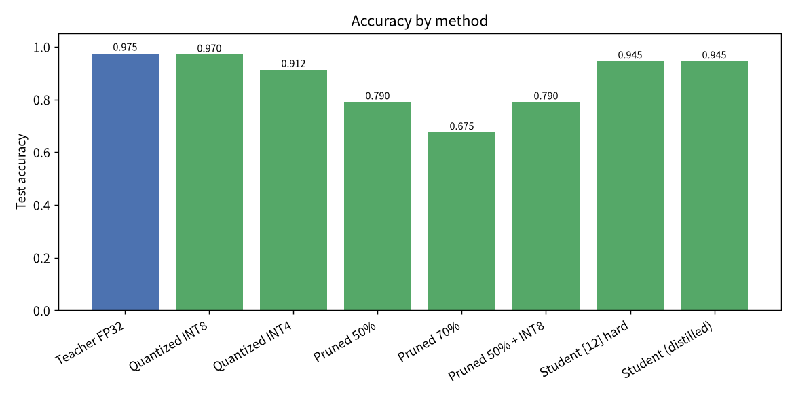

# 🗜️ ModelShrink 模型压缩工具箱

**🌐 语言：简体中文 · [繁體中文](README.zh-TW.md) · [English](../README.md)**

> 一个超轻量、依赖极少的神经网络压缩工具箱——用纯 NumPy 实现**量化**、**剪枝**与**知识蒸馏**，CPU 上几秒跑完。无需 PyTorch/TensorFlow，无需 GPU，也没有繁琐配置。🍃

[](../LICENSE)
[](https://www.python.org/)
[](https://numpy.org/)

---

## 🎉 项目介绍

现代神经网络普遍**严重过参数化**：同样的准确率，往往用一个小 **4 倍、8 倍甚至 18 倍**的模型就能实现。但经典的压缩技术分散在各种重型框架里，学习时很难真正「跑起来、看明白」。

**ModelShrink** 把三大主力技术整合进一个透明、可运行的工具箱：

- **量化（Quantization）**——用更少的位宽（INT8 / INT4）存储权重。
- **剪枝（Pruning）**——移除冗余权重，制造稀疏。
- **知识蒸馏（Knowledge Distillation）**——把大「教师」的知识迁移给极小的「学生」。

从网络结构、前向/反向传播、优化器，到三种压缩算法，全部用**纯 NumPy 从零实现**。完整演示在笔记本 CPU 上**约 4 秒**即可训练并评估完成。

它非常适合**学习与教学**、**快速原型验证**，也可作为读懂「这些技术到底怎么运作」的参考实现。灵感来自「统一模型优化库」这一类项目，但此处代码完全独立、为清晰易读而写，而非追求框架覆盖面。

## ✨ 核心特性

- 🪶 **真正轻量**——运行时唯一依赖就是 **NumPy**。无需 GPU、无需重型框架，几秒装好。
- 🔢 **训练后量化**——支持对称/非对称方案、逐张量/逐通道粒度、**任意位宽**（INT2…INT16），并直接给出重建误差（MSE / 余弦 / SNR）。
- ✂️ **幅值剪枝**——支持全局或逐层稀疏目标，以及**结构化通道剪枝**；剪枝掩码在前向传播、梯度与每次参数更新时都会强制生效。
- 🎓 **知识蒸馏**——温度软化的软标签与硬标签组合，组合梯度经过解析推导。
- 🧠 **完整可训练的 NumPy MLP**——Adam 优化器、**余弦学习率衰减**与梯度裁剪，收敛稳定、可复现。
- 🧪 **充分测试**——单元测试包含对反向传播和蒸馏损失的**梯度数值检验**。
- 🖥️ **友好的命令行**——一条命令跑完整条流水线；支持 JSON 报告与可选图表（matplotlib）。
- 📦 **跨平台**——纯 Python、与操作系统无关，Windows / macOS / Linux 均可 pip 安装。

## 🚀 快速开始

**环境要求：** Python **3.8+** 与 NumPy（会自动安装）。

```bash
# 方式一：从 PyPI 安装（或从克隆的仓库安装）
pip install modelshrink

# 跑完整流水线（训练 → 量化 → 剪枝 → 蒸馏 → 对比）
modelshrink demo
```

从源码运行：

```bash
git clone https://github.com/gitstq/model-shrink.git
cd model-shrink
pip install -e .          # 安装 NumPy 与 `modelshrink` 命令
modelshrink demo
```

只需如此。你会看到类似下面的对比（数值可复现）：

| 方法 | 测试准确率 | 参数量 | 估算字节 | 压缩比 |
|---|---|---|---|---|
| 教师 FP32 | **0.975** | 5,898 | 23,592 | 1.00× |
| 量化 INT8 | 0.970 | 5,898 | 5,898 | **4.00×** |
| 量化 INT4 | 0.913 | 5,898 | 2,949 | **8.00×** |
| 剪枝 50% | 0.790 | 5,898 | 16,752 | 1.41× |
| 剪枝 70% | 0.675 | 5,898 | 10,272 | 2.30× |
| 小学生（蒸馏） | **0.945** | **334** | 1,336 | **17.66×** |

➡️ 一个**小约 18 倍**的模型，保留了教师 **97%** 的准确率。



## 📖 详细使用指南

### 命令行

```bash
modelshrink demo                 # 完整流水线
modelshrink quant --bits 8       # 量化训练好的模型
modelshrink prune --sparsity 0.5 # 剪枝训练好的模型
modelshrink distill --hidden 12  # 蒸馏给极小的学生
```

`demo` 的常用参数：

```bash
modelshrink demo \
  --seed 0 \
  --teacher-epochs 200 \
  --student-epochs 260 \
  --sparsity 0.5 \
  --student-hidden 12 \
  --temperature 2.0 --alpha 0.5 \
  --json report.json \
  --plots docs/assets
```

- `--json 路径`：输出结构化报告。
- `--plots 目录`：保存 `accuracy.png`、`weight_hist.png`、`distill_curves.png`（需要可选依赖 `matplotlib`）。
- `--no-color`：关闭终端颜色。

### 库 API

```python
from modelshrink.data import load_dataset
from modelshrink.nn import MLP
from modelshrink.quantize import quantize_model
from modelshrink.prune import prune_model
from modelshrink.distill import distill

data = load_dataset(seed=0)
f, k = data["n_features"], data["n_classes"]

teacher = MLP([f, 64, 64, k], seed=1)
teacher.fit(data["X_train"], data["y_train"], epochs=200)

print(quantize_model(teacher, bits=8)["error"])  # 权重建表误差
prune_model(teacher, sparsity=0.5)               # 原地剪枝

student = MLP([f, 12, k], seed=7)
distill(teacher, student, data["X_train"], data["y_train"],
        temperature=2.0, alpha=0.5, epochs=260)
print(student.accuracy(data["X_test"], data["y_test"]))
```

可直接运行的完整示例见 [`examples/basic_usage.py`](../examples/basic_usage.py)。

### 量化细节

- **对称量化**：以零为中心映射权重范围（适合天然有正有负的权重，零被精确保留）。
- **非对称（仿射）量化**：同时使用缩放因子与零点，且范围始终覆盖零，适合偏移/无符号分布。
- **逐通道量化**：为每个输出通道单独计算缩放因子，通常比逐张量更精确。

### 关于蒸馏增益的说明 🧐

这里蒸馏最核心的收益是**参数效率**：极小的学生用少约 18 倍的参数达到教师的准确率。在干净、易分的数据集上，同一模型用软标签相对硬标签的「额外」增益可能很小、且随随机种子波动——这是众所周知的结果，并非 bug。当教师确实掌握学生难以获得的信息时（如标签噪声/重叠，或学生的数据、算力受限），软标签的增益最大也最可靠。ModelShrink 选择正确、透明地实现机制，而不是夸大数字。

## 💡 设计思路与迭代规划

**为什么用纯 NumPy？** 目标是「可见性」。每一步操作——反向传播、量化器的整数网格、剪枝掩码、蒸馏梯度——都只有寥寥数行，可读可验证（测试甚至对梯度做了数值检验）。重型框架恰恰会掩盖项目想教的东西。

**工程选择**

- **Adam + 余弦学习率衰减 + 梯度裁剪**，让收敛稳定、基本不受 mini-batch 顺序影响。
- **伪量化**（量化 → 反量化）让现有 NumPy 网络无需改动即可运行，同时直接测量误差。
- 二值**剪枝掩码**在各处强制生效，确保零始终为零。

**迭代规划 / 欢迎贡献**

- 🔜 仅权重的整数**打包**工具（真正的紧凑缓冲区，而不只是估算大小）。
- 🔜 「剪枝 → 微调」的迭代策略，以及会改变形状的结构化剪枝。
- 🔜 量化感知训练（QAT）与更多蒸馏损失（特征/提示、对比学习）。
- 🔜 适配更多 NumPy 友好的真实数据集，以及更多语言的文档。

## 📦 打包与部署指南

ModelShrink 是**库 + 命令行**，以纯 Python wheel 形式分发，因此在 Windows、macOS、Linux 上行为一致。

```bash
pip install .                      # 本地安装
python3 -m build                   # 构建 sdist + wheel（需要 build）
pip install dist/modelshrink-*.whl # 安装构建好的 wheel
```

没有原生/编译组件，也不依赖 GPU。命令行 `modelshrink` 通过标准的 `pyproject.toml` 入口点提供。

## 🤝 贡献指南

非常欢迎贡献！🛠️

1. 先开一个 **Issue** 讨论 bug 或想法。
2. Fork、建分支，提交聚焦的改动（`feat:` / `fix:` / `docs:` / `refactor:`）。
3. 补充或调整测试并运行：`make test`（`python3 -m unittest discover -s tests`）。
4. 提交 **Pull Request**，说明改动内容。

请保持代码易读、依赖轻量——这正是项目的精神。详见 [CONTRIBUTING.md](../CONTRIBUTING.md)。

## 📄 开源协议

基于 **MIT 协议**开源——见 [LICENSE](../LICENSE)。放心使用、学习，打造更小更快的东西吧。🚀
