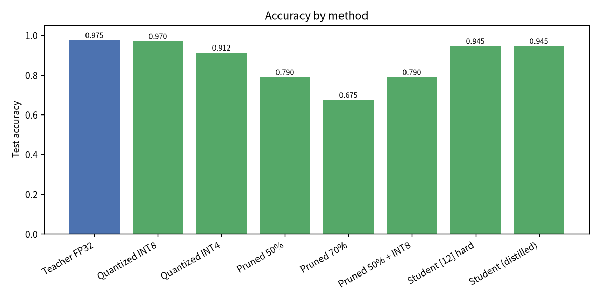

# 🗜️ ModelShrink 模型壓縮工具箱

**🌐 語言：[简体中文](README.zh-CN.md) · 繁體中文 · [English](../README.md)**

> 一個超輕量、相依極少的類神經網路壓縮工具箱——以純 NumPy 實作**量化**、**剪枝**與**知識蒸餾**，CPU 上幾秒跑完。不需要 PyTorch/TensorFlow、不需要 GPU，也沒有繁瑣設定。🍃

[](../LICENSE)
[](https://www.python.org/)
[](https://numpy.org/)

---

## 🎉 專案介紹

現今的類神經網路普遍**嚴重過度參數化**：同樣的正確率，往往用一個小上 **4 倍、8 倍甚至 18 倍**的模型就能達成。但經典的壓縮技術散落在各種重型框架中，學習時很難真正「跑得起來、看得明白」。

**ModelShrink** 把三大主力技術整合進一個透明、可執行的工具箱：

- **量化（Quantization）**——以更少的位元寬（INT8 / INT4）儲存權重。
- **剪枝（Pruning）**——移除冗餘權重，製造稀疏。
- **知識蒸餾（Knowledge Distillation）**——把大型「教師」的知識移轉給極小的「學生」。

從網路結構、前向/反向傳播、最佳化器，到三種壓縮演算法，全部以**純 NumPy 從零實作**。完整展示在筆記型電腦的 CPU 上**約 4 秒**即可完成訓練與評估。

它非常適合**學習與教學**、**快速原型驗證**，也能作為讀懂「這些技術實際上如何運作」的參考實作。靈感來自「統一模型最佳化函式庫」這一類專案，但此處的程式碼完全獨立、為了清晰易讀而撰寫，而非追求框架的涵蓋範圍。

## ✨ 核心特性

- 🪶 **真正輕量**——執行時唯一的相依套件就是 **NumPy**。不需要 GPU、不需要重型框架，幾秒鐘即可安裝。
- 🔢 **訓練後量化**——支援對稱/非對稱方案、逐張量/逐通道粒度、**任意位元寬**（INT2…INT16），並直接量測重建誤差（MSE / 餘弦 / SNR）。
- ✂️ **幅值剪枝**——支援全域或逐層稀疏目標，以及**結構化通道剪枝**；剪枝遮罩在前向傳播、梯度與每次參數更新時都會強制生效。
- 🎓 **知識蒸餾**——以溫度軟化的軟標籤結合硬標籤，組合梯度經過解析推導。
- 🧠 **完整、可訓練的 NumPy MLP**——Adam 最佳化器、**餘弦學習率衰減**與梯度裁剪，收斂穩定、可重現。
- 🧪 **嚴謹測試**——單元測試包含對反向傳播與蒸餾損失的**梯度數值檢驗**。
- 🖥️ **友善的命令列**——一道指令跑完整條流程；支援 JSON 報告與可選圖表（matplotlib）。
- 📦 **跨平台**——純 Python、與作業系統無關，Windows / macOS / Linux 皆可使用 pip 安裝。

## 🚀 快速開始

**環境需求：** Python **3.8+** 與 NumPy（會自動安裝）。

```bash
# 方式一：從 PyPI 安裝（或從克隆下來的專案安裝）
pip install modelshrink

# 執行完整流程（訓練 → 量化 → 剪枝 → 蒸餾 → 比較）
modelshrink demo
```

從原始碼執行：

```bash
git clone https://github.com/gitstq/model-shrink.git
cd model-shrink
pip install -e .          # 安裝 NumPy 與 `modelshrink` 指令
modelshrink demo
```

就這麼簡單。你會看到類似以下的比較（數值可重現）：

| 方法 | 測試正確率 | 參數數量 | 估算位元組 | 壓縮比 |
|---|---|---|---|---|
| 教師 FP32 | **0.975** | 5,898 | 23,592 | 1.00× |
| 量化 INT8 | 0.970 | 5,898 | 5,898 | **4.00×** |
| 量化 INT4 | 0.913 | 5,898 | 2,949 | **8.00×** |
| 剪枝 50% | 0.790 | 5,898 | 16,752 | 1.41× |
| 剪枝 70% | 0.675 | 5,898 | 10,272 | 2.30× |
| 小學生（蒸餾） | **0.945** | **334** | 1,336 | **17.66×** |

➡️ 一個**小約 18 倍**的模型，保留了教師 **97%** 的正確率。



## 📖 詳細使用指南

### 命令列

```bash
modelshrink demo                 # 完整流程
modelshrink quant --bits 8       # 量化訓練好的模型
modelshrink prune --sparsity 0.5 # 剪枝訓練好的模型
modelshrink distill --hidden 12  # 蒸餾給極小的學生
```

`demo` 的常用參數：

```bash
modelshrink demo \
  --seed 0 \
  --teacher-epochs 200 \
  --student-epochs 260 \
  --sparsity 0.5 \
  --student-hidden 12 \
  --temperature 2.0 --alpha 0.5 \
  --json report.json \
  --plots docs/assets
```

- `--json 路徑`：輸出結構化報告。
- `--plots 目錄`：儲存 `accuracy.png`、`weight_hist.png`、`distill_curves.png`（需要可選相依套件 `matplotlib`）。
- `--no-color`：關閉終端機顏色。

### 函式庫 API

```python
from modelshrink.data import load_dataset
from modelshrink.nn import MLP
from modelshrink.quantize import quantize_model
from modelshrink.prune import prune_model
from modelshrink.distill import distill

data = load_dataset(seed=0)
f, k = data["n_features"], data["n_classes"]

teacher = MLP([f, 64, 64, k], seed=1)
teacher.fit(data["X_train"], data["y_train"], epochs=200)

print(quantize_model(teacher, bits=8)["error"])  # 權重重建誤差
prune_model(teacher, sparsity=0.5)               # 原地剪枝

student = MLP([f, 12, k], seed=7)
distill(teacher, student, data["X_train"], data["y_train"],
        temperature=2.0, alpha=0.5, epochs=260)
print(student.accuracy(data["X_test"], data["y_test"]))
```

可直接執行的完整範例位於 [`examples/basic_usage.py`](../examples/basic_usage.py)。

### 量化細節

- **對稱量化**：以零為中心對應權重範圍（適合天生有正有負的權重，零會被精確保留）。
- **非對稱（仿射）量化**：同時使用縮放因子與零點，且範圍永遠涵蓋零，適合偏移/無號分布。
- **逐通道量化**：為每個輸出通道分別計算縮放因子，通常比逐張量更精確。

### 關於蒸餾增益的說明 🧐

這裡蒸餾最主要的益處是**參數效率**：極小的學生用少約 18 倍的參數達到教師的正確率。在乾淨、容易區分的資料集上，同一個模型使用軟標籤相對於硬標籤的「額外」增益可能很小、且隨隨機種子波動——這是廣為人知的結果，並非 bug。當教師確實擁有學生難以取得的資訊時（例如標籤雜訊/重疊，或學生的資料、運算資源受限），軟標籤的增益最大也最可靠。ModelShrink 選擇正確、透明地實作機制，而非誇大數字。

## 💡 設計思路與迭代規劃

**為什麼使用純 NumPy？** 目標是「可見性」。每一道運算——反向傳播、量化器的整數網格、剪枝遮罩、蒸餾梯度——都只有短短幾行，可讀也可驗證（測試甚至對梯度做了數值檢驗）。重型框架反而會遮蔽這個專案想傳達的東西。

**工程選擇**

- **Adam + 餘弦學習率衰減 + 梯度裁剪**，讓收斂穩定、幾乎不受 mini-batch 順序影響。
- **偽量化**（量化 → 反量化）讓現有的 NumPy 網路無需改動即可執行，同時直接量測誤差。
- 二值**剪枝遮罩**在各處強制生效，確保零永遠是零。

**迭代規劃 / 歡迎貢獻**

- 🔜 僅針對權重的整數**打包**輔助函式（真正的緊湊緩衝區，而不只是估算大小）。
- 🔜 「剪枝 → 微調」的迭代排程，以及會改變形狀的結構化剪枝。
- 🔜 量化感知訓練（QAT）與更多蒸餾損失（特徵/提示式、對比式）。
- 🔜 支援更多對 NumPy 友善的真實資料集，以及更多語言的文件。

## 📦 打包與部署指南

ModelShrink 是**函式庫 + 命令列工具**，以純 Python wheel 形式散發，因此在 Windows、macOS、Linux 上行為一致。

```bash
pip install .                      # 本機安裝
python3 -m build                   # 建置 sdist + wheel（需要 build）
pip install dist/modelshrink-*.whl # 安裝建置好的 wheel
```

沒有原生/編譯元件，也不需要 GPU。命令列指令 `modelshrink` 透過標準的 `pyproject.toml` 進入點提供。

## 🤝 貢獻指南

非常歡迎貢獻！🛠️

1. 先開一個 **Issue** 討論 bug 或構想。
2. Fork、建立分支，提交聚焦的變更（`feat:` / `fix:` / `docs:` / `refactor:`）。
3. 新增或調整測試並執行：`make test`（`python3 -m unittest discover -s tests`）。
4. 送出 **Pull Request**，說明變更內容。

請保持程式碼易讀、相依套件輕量——這正是本專案的精神。詳見 [CONTRIBUTING.md](../CONTRIBUTING.md)。

## 📄 開源授權條款

以 **MIT 授權**釋出——見 [LICENSE](../LICENSE)。儘管使用、學習，打造更小更快的東西吧。🚀
